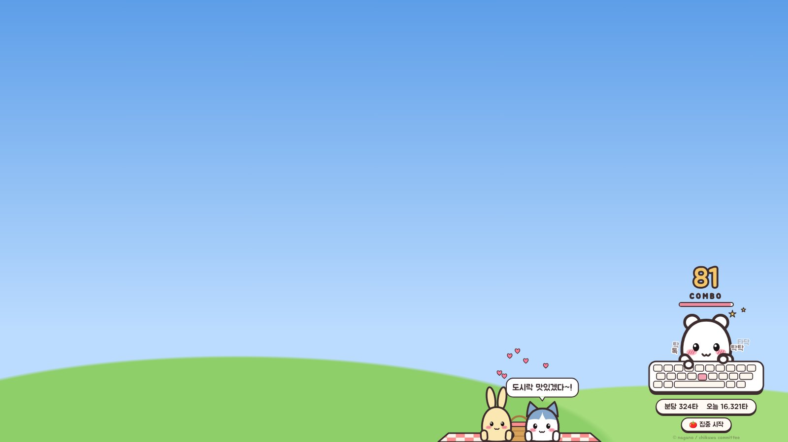
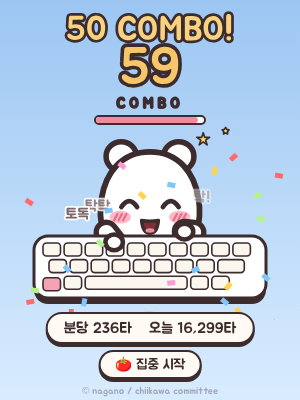
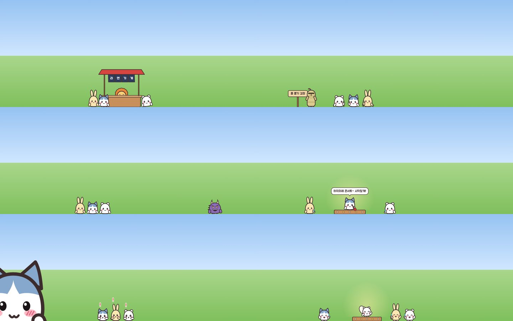
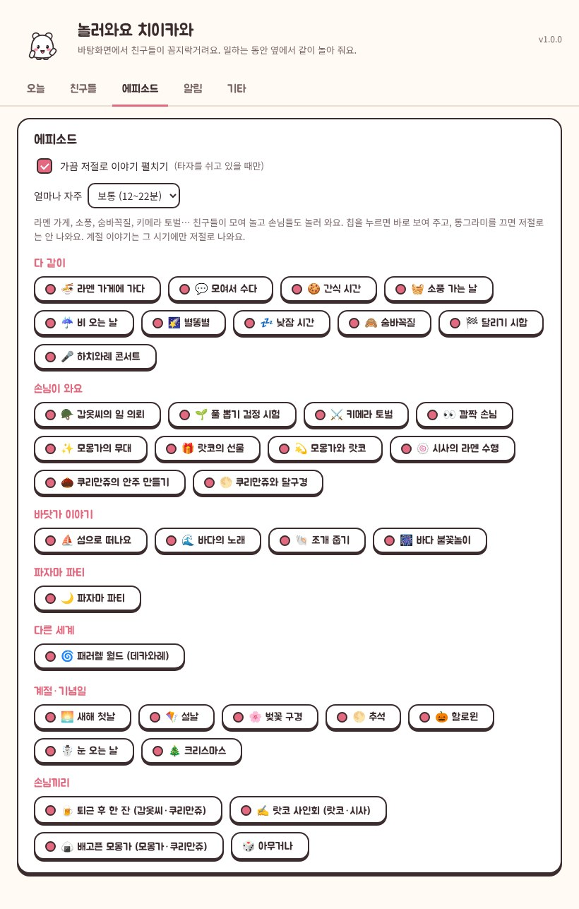
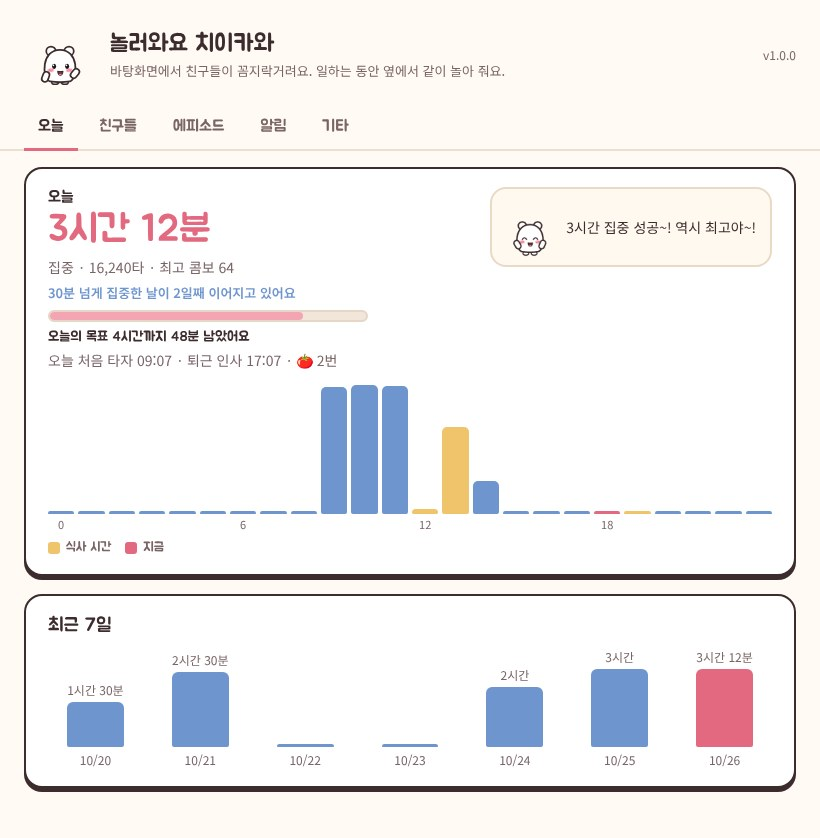
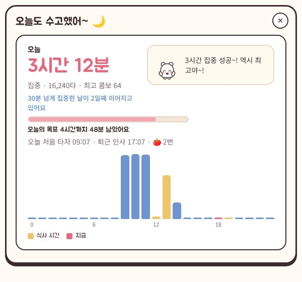
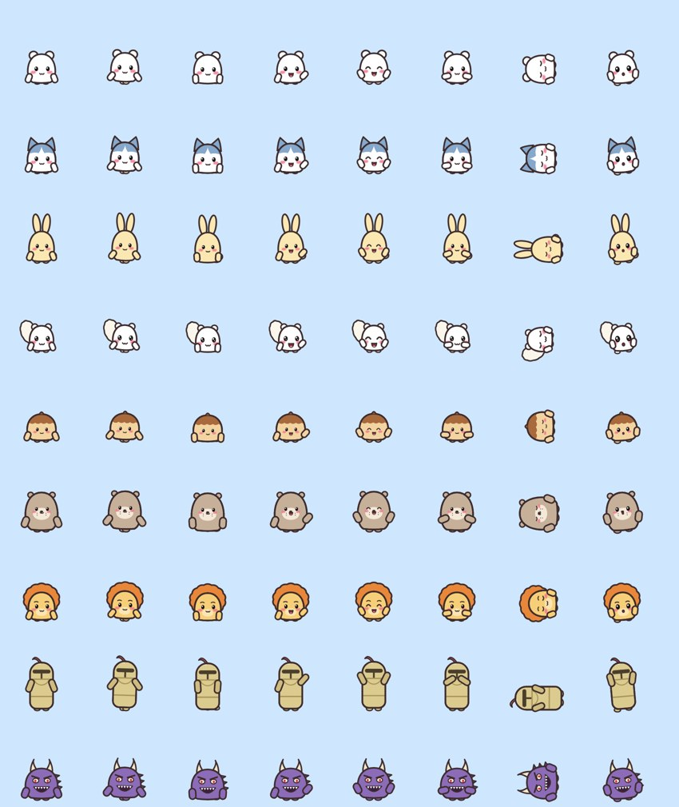

# 놀러와요 치이카와 데스크톱 🌱

바탕화면에서 **치이카와·하치와레·우사기**가 꼼지락거리는 프로그램이에요. 일하는 동안 옆에서 같이 놀아 줘요!
봉고캣처럼 타자를 치면 책상에 앉은 친구가 같이 두드리고, 타자를 쉬는 동안에는 바탕화면에서 이야기를 펼쳐요.

> 개인이 재미로 쓰려고 만든 **비상업 팬 메이드** 앱이에요. 치이카와 캐릭터의 권리는 © nagano / chiikawa committee에 있고,
> 그림은 모두 코드로 새로 그렸어요(공식 이미지 파일은 들어 있지 않아요). 판매하거나 상업적으로 배포하지 말아 주세요.
> 설정의 **캐릭터** 탭에서 이 저장소의 ODD HAUS 친구들(레코드 Vin, 기타 피크 Picker, 건전지 A.A., 열쇠 Locke, 체스 킹 Rex)로 바꿀 수도 있어요.



## 📦 받기

- 이 저장소의 **Actions → ODD HAUS Desktop** 워크플로가 `desktop/`이 바뀔 때마다 Windows와 macOS용 zip을 만들어 실행 결과의 **Artifacts**에 올려요.
  - `OddHausDesktop-Windows`: Windows x64
  - `OddHausDesktop-macOS`: 인텔 칩(x64)과 애플 칩(arm64) zip이 같이 들어 있어요.
- `desktop-v1.0.0` 같은 태그를 push하면 같은 파일이 **Releases**에도 올라가요. 앱 설정 화면이 Releases를 보고 새 버전을 알려 줘요.

## 🛠️ 설치 방법

**Windows**

1. zip을 풀고 `OddHausDesktop.exe`를 실행해요.
2. "Windows의 PC 보호" 창이 뜨면 **[추가 정보] → [실행]**을 눌러 주세요. 코드 서명을 안 해서 뜨는 창이라 놀라지 않으셔도 돼요.
3. 화면 아래에 하치와레와 우사기가 짠 하고 나타나고, 오른쪽 아래에 치이카와가 앉은 타자 책상이 생겨요. 설정은 작업 표시줄 트레이 아이콘을 우클릭하면 돼요.

**macOS**

1. zip을 풀고 `ODD HAUS Desktop.app`을 응용 프로그램 폴더로 옮겨요.
2. 서명 안 된 앱이라 처음 한 번은 **우클릭 → 열기**로 열어 주세요.
3. 타자 반응을 쓰려면 **시스템 설정 → 개인정보 보호 및 보안 → 손쉬운 사용**에서 ODD HAUS Desktop을 허용해 주세요. 허용하면 바로 시작해요.
4. 메뉴 막대의 치이카와 아이콘을 누르면 메뉴가 나와요.

## ✨ 이런 기능들이 있어요

### ⌨️ 타자 콤보



- 키보드를 칠 때마다 책상에 앉은 친구가 양손으로 번갈아 뿅뿅 두드려요. 스페이스는 쿵, 엔터는 뿅, 지우기는 슥슥 지우면서 땀을 흘려요.
- 콤보가 쌓이면 10 · 30 · 50 · 100 · 200 · 300 · 500 · 777 · 1000 COMBO마다 알려 주고 색종이를 뿌려요.
- 분당 타수와 오늘 친 타수를 보여 줘요.
- 책상은 끌어서 원하는 곳에 둘 수 있고, 책상 친구를 클릭하면 반응해요. 우클릭하면 메뉴가 나와요.
- **🍅 집중 시작**을 누르면 25분 집중 + 5분 쉬기 타이머가 돌아가요. 집중하는 동안 책상 친구가 안경을 써요.
- 에피소드가 열리면 책상 친구도 잠깐 자리를 비우고 놀러 가요("잠깐 놀러 갔어요~").

### 🎬 가끔 펼쳐지는 에피소드 36가지



- 책상에 없는 친구들은 바탕화면 아래를 알아서 돌아다니고, 듀얼·트리플 모니터도 넘나들어요. 클릭하면 폴짝 뛰고, 끌어서 떨어뜨리면 어지러워해요.
- 서로 마주치면 수다를 떨고, 쉬는 시간이 길어지면 꾸벅꾸벅 졸아요.
- 타자를 쉬고 있을 때 가끔 이야기가 펼쳐져요. 설정의 **에피소드** 탭에서 칩을 누르면 바로 볼 수 있어요.



| 분류 | 이야기 |
|---|---|
| 다 같이 | 🍜 라멘 가게에 가다 · 💬 모여서 수다 · 🍪 간식 시간 · 🧺 소풍 가는 날 · ☔ 비 오는 날 · 🌠 별똥별 · 💤 낮잠 시간 · 🙈 숨바꼭질 · 🏁 달리기 시합 · 🎤 하치와레 콘서트 |
| 손님이 와요 | 🪖 갑옷씨의 일 의뢰 · 🌱 풀 뽑기 검정 시험 · ⚔️ 키메라 토벌 · 👀 깜짝 손님 · ✨ 모몽가의 무대 · 🎁 랏코의 선물 · 💫 모몽가와 랏코 · 🍥 시사의 라멘 수행 · 🌰 쿠리만쥬의 안주 만들기 · 🌕 쿠리만쥬와 달구경 |
| 바닷가 이야기 | ⛵ 섬으로 떠나요 · 🌊 바다의 노래 · 🐚 조개 줍기 · 🎆 바다 불꽃놀이 |
| 파자마 파티 | 🌙 파자마 파티 |
| 다른 세계 | 🌀 패러렐 월드 (데카와레) |
| 계절·기념일 | 🌅 새해 첫날 · 🪁 설날 · 🌸 벚꽃 구경 · 🌕 추석 · 🎃 할로윈 · ☃️ 눈 오는 날 · 🎄 크리스마스 |
| 손님끼리 | 🍺 퇴근 후 한 잔 (갑옷씨·쿠리만쥬) · ✍️ 랏코 사인회 (랏코·시사) · 🍙 배고픈 모몽가 (모몽가·쿠리만쥬) · 🎲 아무거나 |

- 손님: 모몽가, 쿠리만쥬, 랏코, 시사, 갑옷씨, 키메라, 그리고 다른 세계에서 온 커다란 하치와레.
- 원본의 극장판「인어 섬의 비밀」 이야기(세이렌·한잎·두잎·인어)와 카니는 캐릭터 모습을 정확히 몰라서 넣지 않았고, 대신 '바닷가 이야기'와 '랏코의 선물', '모몽가와 랏코'를 넣었어요.
- 계절 이야기는 그 시기에만 저절로 나와요(설날·추석은 음력 날짜를 따라가요). 지금 보기는 언제든 돼요.
- '하치와레 콘서트'처럼 주인공이 정해진 이야기는 그 친구가 돌아다니거나 책상에 앉아 있어야 볼 수 있어요.

### ⏰ 은근 쓸모 있는 기능도 있어요



- 점심(11:50~14:00)·저녁(18:00~20:00)에 아직 타자를 치고 있으면 밥 먹으라고 챙겨 줘요.
- 쉬지 않고 50분 일하면 기지개, 집중 90분마다 물 마시기를 알려 줘요. 시간은 바꿀 수 있어요.
- 오늘 처음 타자 친 시각 + 8시간이 되면 "오늘도 수고했어~" 하면서 하루 요약을 보여 줘요.

  
- 오늘의 목표(기본 4시간), 1시간마다 칭찬, 30분 넘게 집중한 날이 며칠째 이어지는지, 시간대별 집중 그래프와 최근 7일 기록을 보여 줘요.

### 🤖 AI 말투 변환 (선택)

- 설정 → 기타에서 직접 Anthropic API 키를 넣고 켜면, 알림 문장을 책상 친구 말투로 바꿔 줘요.
  예: "물 한 잔 마시고 오자 💧" → (우사기) "우라! 물! 야하!"
- 모델은 Claude Opus 5.5(기본), Sonnet 5.5, Haiku 5.5 중에서 고를 수 있어요.

## 🔒 키보드 감지, 안심하셔도 돼요

- 타자 반응 때문에 키보드 입력을 감지하긴 하지만, **'키를 눌렀다'는 사실과 엔터·스페이스·지우기 구분만** 써요. 무슨 키를 눌렀는지는 저장하지도 않고 어디로 보내지도 않아요. (키를 누르고 있는 동안 자동 반복을 거르려고 키 번호를 잠깐 메모리에만 들고 있다가 키를 떼면 바로 버려요. `src/main/keyboard.js`, `src/main/typing.js`)
- 집중 기록도 시간대별 숫자만 내 PC에 저장되고 밖으로 나가지 않아요. 기록 위치는 설정 → 기타 → 기록 폴더 열기에서 볼 수 있어요.
- AI 말투 변환은 직접 API 키를 넣고 켰을 때만 인터넷을 써요. 보내는 건 앱이 정한 알림 문장과 캐릭터 설명뿐이에요. 키는 OS 보안 저장소(Windows DPAPI, macOS 키체인)로 암호화해서 보관해요.
- 그 밖의 인터넷 사용은 GitHub Releases에서 새 버전을 확인하는 것뿐이에요.
- 그래도 찜찜하시면 설정에서 **'타자 치면 반응하기'**를 끄세요. 그러면 키보드 감지 자체를 안 해요.

## 🧑‍💻 직접 실행하고 빌드하기

Node.js 22 이상이 필요해요.

```bash
cd desktop
npm ci
npm start          # 앱 실행
npm test           # 단위 테스트 + 36개 에피소드를 끝까지 돌려 보는 시뮬레이션
npm run dist:win   # dist/OddHausDesktop-<버전>-win-x64.zip
npm run dist:mac   # macOS에서: x64 + arm64 zip
```

- `npm run preview`: 브라우저(Playwright Chromium)에서 모든 창과 에피소드를 가짜 메인 프로세스로 띄워서 `preview-out/`에 스크린샷을 남겨요. 그림을 고칠 때 편해요.
- `npm run icons`: 앱·트레이 아이콘을 캐릭터 그림 코드로 다시 만들어요.
- 브라우저에서 바로 보기: `node tools/serve.mjs` 후 `http://127.0.0.1:8090/tools/preview/scene.html?typing=1&ep=capboat`
  (`ep=<에피소드 id>`, `typing=1`, `remind=lunch`, `friend=rex`, `speed=3` 같은 옵션이 있어요)

## 🗂️ 구조

| 경로 | 하는 일 |
|---|---|
| `src/main/main.js` | 창(화면마다 투명 오버레이 하나, 책상, 설정, 하루 요약), 트레이, IPC |
| `src/main/keyboard.js` · `typing.js` | 키보드 훅(uiohook-napi) → 종류만 남기기, 자동 반복 거르기, 콤보·분당 타수 |
| `src/main/stats.js` | 날짜별·시간대별 타수와 집중 시간, 연속 기록 |
| `src/main/scheduler.js` | 밥·기지개·물·칭찬·목표·퇴근 알림, 뽀모도로 |
| `src/main/ai.js` | AI 말투 변환(Anthropic SDK) |
| `src/renderer/shared/draw.js` · `props.js` · `fx.js` | 캐릭터, 손님, 소품, 효과를 전부 Canvas 코드로 그려요(이미지 파일 없음) |
| `src/renderer/shared/chiikawa.js` | 치이카와·하치와레·우사기와 손님들 |
| `src/renderer/overlay/` | 바탕화면 세계(`world.js`), 에피소드 감독(`director.js`), 캐릭터별 이야기(`episodes-chiikawa.js`, `episodes-oddhaus.js`) |
| `src/renderer/desk/` | 타자 콤보 책상 |
| `src/renderer/settings/` | 설정 창과 하루 요약 |
| `test/` | `npm test` |

여러 모니터: 주 모니터의 오버레이가 세계를 돌리고, 다른 모니터의 오버레이는 1초에 30번 받는 스냅샷을 그려요. 그래서 친구가 모니터 경계를 걸어서 넘어가요.

## 캐릭터에 대해



- 치이카와 캐릭터: © nagano / chiikawa committee. 이 앱은 개인이 즐기려고 만든 비상업 팬 메이드예요. 공식 이미지를 가져다 쓰지 않고 코드로 새로 그렸어요.
- ODD HAUS 캐릭터는 이 저장소의 브랜드 필름 캐릭터(`legacy/v1-concept/spec/characters.json`)를 2D로 다시 그린 것이에요.
- 폰트는 Jua(SIL Open Font License, `src/renderer/fonts/OFL.txt`)를 자주 쓰는 한글만 남겨서 넣었어요.
