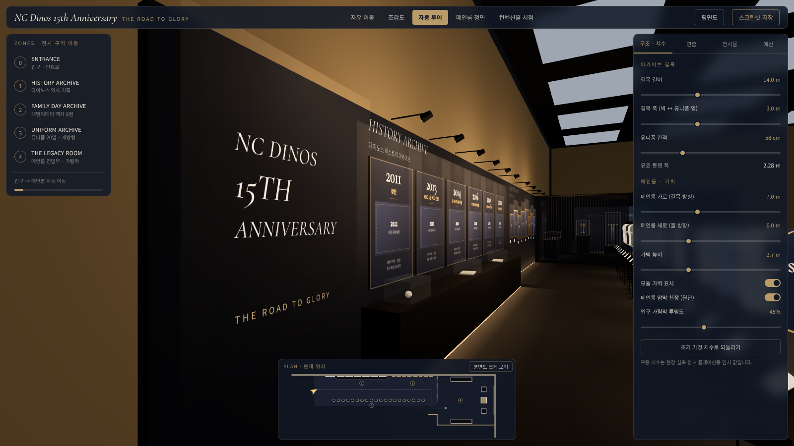
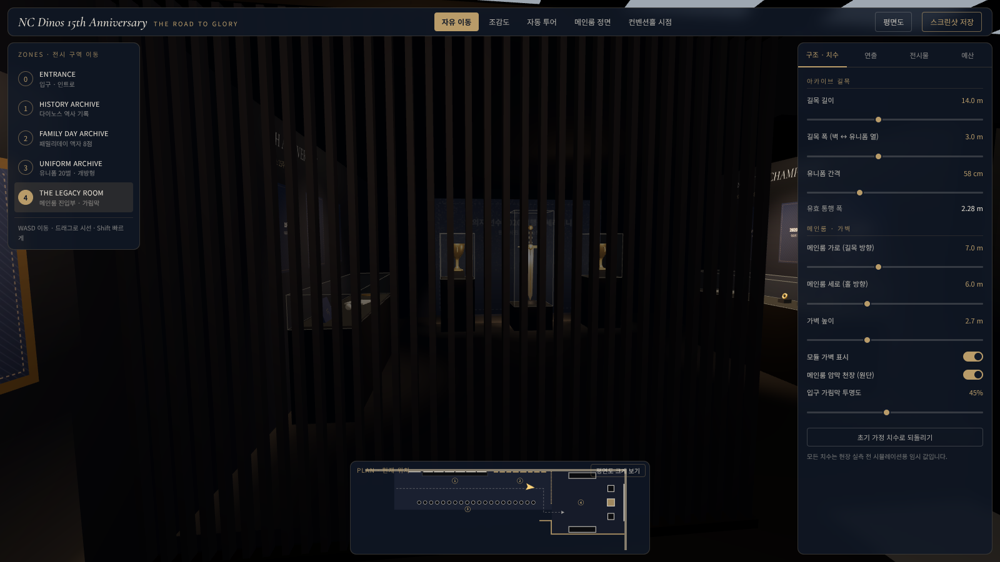
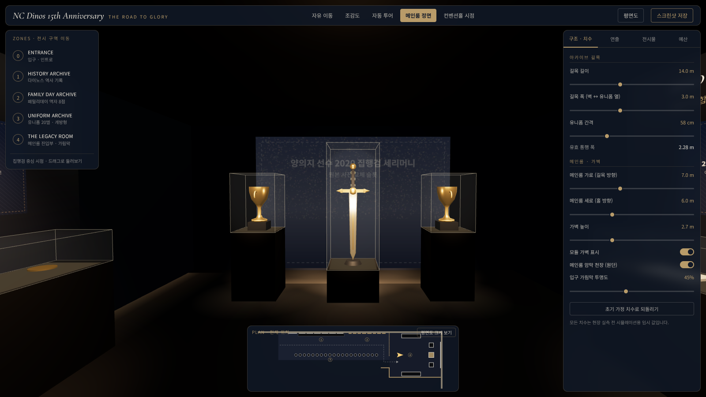
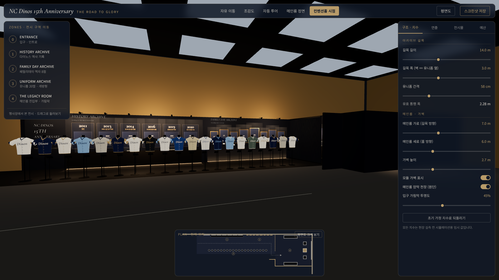
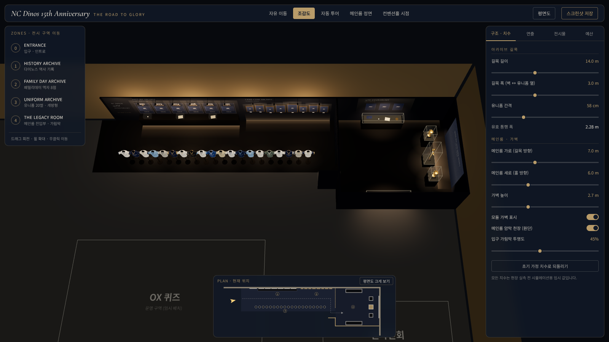
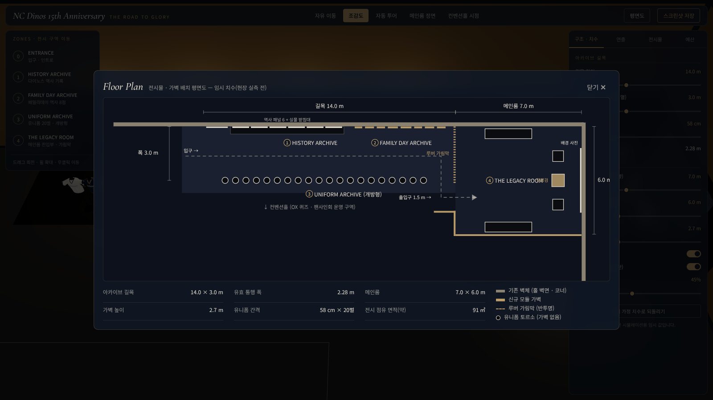

# NC DINOS 15TH ANNIVERSARY — Interactive 3D Exhibition Simulator

NC 다이노스 패밀리데이 특별 전시(NC R&D센터 B1 컨벤션홀)를 웹에서 걸어 다니며 확인하는 3D 전시 시뮬레이터입니다.
행사 대행사에 콘셉트 · 공간 배치 · 관람 동선 · 구조물 설치 범위를 설명하는 용도입니다.

React + TypeScript + Vite · Three.js + React Three Fiber + Drei · Tailwind CSS. 외부 3D 모델 없이 기본 도형과 재질만 사용합니다.

## 실행

```bash
npm install
```

```bash
npm run dev
```

배포용 빌드는 `npm run build` → `dist/` (상대 경로 빌드라 정적 호스팅에 그대로 올릴 수 있습니다).

## 화면

| | |
|---|---|
|  |  |
|  |  |
|  |  |

## 공간 구성 (임시 치수 — 현장 실측 전)

| 구역 | 내용 |
|---|---|
| ① HISTORY ARCHIVE | 기존 홀 벽면 위 네이비 그래픽 마감 + 연혁 패널 6 + 실물 받침대 |
| ② FAMILY DAY ARCHIVE | 세로형 액자 8점 (2014·15·16·17·20·21·22·23), 크기·높이 상이 |
| ③ UNIFORM ARCHIVE | 남성 상반신 토르소 20개(수직봉 + 원형 받침 + 명패). **뒤 가벽 없음**, 홀 방향 개방 |
| ④ THE LEGACY ROOM | 홀 코너의 기존 벽 2면 + 모듈 가벽 2면. 좌 15주년 / 중앙 집행검·트로피 2 / 우 2020 우승 기념품 |

- 길목 끝 정면은 **세로 루버 + 반투명 스크림** 가림막이라 집행검·트로피의 실루엣과 빛만 비칩니다. 출입구는 우측으로 꺾인 위치(1.5 m)이며, 날개벽 1장이 홀 쪽 시선을 막습니다.
- 초기 가정: 길목 14 × 3 m, 메인룸 7 × 6 m, 가벽 높이 2.7 m. 모두 우측 패널에서 변경할 수 있습니다.

## 기능

- **카메라 5종**: 자유 이동(WASD · 드래그 시선 · Shift 가속 · 충돌 처리) / 조감도 / 자동 투어 / 메인룸 정면 / 컨벤션홀 시점
- **구조 · 치수**: 길목 길이·폭, 유니폼 간격, 메인룸 크기, 가벽 높이, 가벽 표시/숨김, 암막 천장, 가림막 투명도. 유효 통행 폭과 유니폼 열 초과를 자동 경고
- **연출**: 메인룸 A/B/C 연출 비교, 배경 사진 밝기, 집중 조명, 홀 기존 조명
- **전시물**: 3D에서 클릭해 규격 확인 · 이미지 교체 · 쇼케이스 위치 조절
- **평면도**: 하단 미니맵(현재 위치) + 치수 표기 전체 평면도
- **예산표**: 추정 금액과 실제 견적을 구분해 편집, 2,000만 원 한도 대비 표시 (브라우저에 저장)
- **스크린샷 저장**: 현재 3D 화면을 PNG로 저장

## 실제 이미지로 교체하기

1. 앱에서: 전시물을 클릭 → 우측 `전시물` 탭 → `이미지 파일 선택` (세션 동안만 유지)
2. 영구 반영: 파일을 `public/assets/` 에 넣고 `src/data/content.ts` 의 해당 항목에 `image: 'assets/파일명.jpg'` 지정

- 유니폼은 **정면 사진**을 올리면 토르소 전·후면에 평면 투영됩니다.
- 집행검 배경(양의지 선수 2020 세리머니) 사진은 업로드 시 채도를 낮추고 네이비 오버레이를 씌웁니다. 현재는 플레이스홀더입니다.

## 확인이 필요한 내용

- 연혁 패널은 널리 알려진 6개 항목(2011 창단, 2013 1군 진입, 2014 첫 포스트시즌, 2016 첫 한국시리즈, 2019 창원NC파크 개장, 2020 통합 우승)의 **제목만** 넣었습니다. 본문·수치·사진은 구단 확인 후 `content.ts` 에 입력하세요.
- 유니폼 20벌의 명칭·색상, 액자 치수, 예산 금액은 모두 플레이스홀더/가정치입니다.
- 컨벤션홀 크기(34 × 20 m, 천장 6 m)와 OX 퀴즈 · 팬사인회 구역 위치는 공간감 확인용 가정입니다.

## 구조

```
src/
  layout.ts          치수 파라미터 → 벽·전시물 좌표, 카메라 포즈, 투어 경로
  store.ts           상태 (zustand)
  data/content.ts    연혁 · 액자 · 유니폼 · 예산 데이터 (이미지 경로 포함)
  three/             Scene, Hall, Corridor, LegacyRoom, CameraRig, parts, textures
  ui/                RightPanel(설정·예산), FloorPlan(미니맵·평면도)
```
