# 03. 그래픽 전면 개선 결과 보고

대상: `eclipse-requiem/game` (Stage 1 빌드). 기존 프로젝트를 새로 만들지 않고 **렌더링 구조와 아트 디렉션을 리팩터링**했다. 분석은 `01_analysis.md`, 구조는 `02_art_system.md`, 에셋 사양·교체 방법은 `../../assets/README.md`.

## 1. 핵심 변경

| 영역 | 이전 (확인된 상태) | 이후 |
|---|---|---|
| 그래픽 소스 | 이미지 파일 0개. 부팅 시 `gfx/art/*.ts` 가 벡터 도형으로 그려 캔버스 생성 | `assets/` 의 PNG 35장 + 시트 JSON 14개(+ stage.json·폰트·팔레트 정의). 코드는 로드·재생만 |
| 캐릭터 | 3프레임, 오라=원호, 창=사각형, 낫=회전 원호 | 6태그(비행/상·하 기울기/차지/피격/캐스트) + 이펙트 시트(총구·오라·발사·폭탄·사망) |
| 보스 | 화면 높이 약 74%, 종을 런타임 회전 | 파츠 합성(머리·몸·양팔·종·코어), 높이 약 51%, 종 기울기·균열은 프레임, 탄 발사구는 슬라이스 |
| 배경 | 그라데이션·다각형, 실시간 생성 | 11개 레이어 이미지 + `stage.json` 패럴랙스, 구간별 타일 교체(디더 디졸브) |
| 탄·이펙트 | `rotate` + 모든 탄에 가산 글로우 | 탄 시트(B03 16방향 프레임), 이펙트 애니메이션 시트, 글로우 패스 삭제 |
| UI | 벡터 웹폰트(Cinzel/Noto), 금 테두리 패널 4개, 하단 차지 패널, ★☆ 기호 | 상단 최소 HUD + 3px 보스 바, 5×7 비트맵 폰트 + Galmuri, 1px 선 패널, 해골 아이콘 |
| 타이틀/선택 | 키아트·글로우·벡터 문장(紋章) | 스테이지 레이어 배경 + 로고 이미지 + 실제 게임 스프라이트, 선택 화면은 초상화·실제 크기 스프라이트·실시간 무기 미리보기 |

코드 내 도형 호출 수 (`src/` 전체, grep 기준):

| 호출 | 이전 | 이후 | 남은 용도 |
|---|---|---|---|
| `fillRect` | 233 | 83 | UI 선·바·게이지, 1–2px 입자, 시야 마스크 바깥 |
| `.arc(` | 38 | 0 | |
| `lineTo` | 53 | 5 | 장면 전환 디더 와이프의 클리핑 다각형 |
| `create*Gradient` | 8 | 0 | |
| `.rotate(` | 17 | 0 | |
| 가산 합성 `lighter` | 9 | 1 | `Sheet.draw` 옵션(현재 미사용) |
| `shadowBlur` | 9 | 0 | |

## 2. 수정 파일

- **신규 런타임**: `src/gfx/assets.ts`(시트 로더·재생), `src/gfx/palette.ts`(팔레트·색 스냅), `src/gfx/pixeltext.ts`(픽셀 폰트), `src/gfx/dither.ts`(디더·셰이드)
- **재작성**: `src/game/stagebg.ts`, `src/game/fx.ts`, `src/ui/hud.ts`, `src/gfx/ui.ts`, `src/gfx/sprites.ts`(시트 키만), `src/ui/logo.ts`, `src/scenes/{backdrops,intro,prologue,artsheet}.ts`
- **그리기 부분 교체(로직 유지)**: `src/game/{player,enemies,midboss,boss,bullets,items,hazards,world}.ts`, `src/scenes/{title,select,preview,game,clear}.ts`, `src/main.ts`, `src/gfx/renderer.ts`(`logical()` 추가)
- **값 조정**: `src/game/defs.ts`(캐릭터 색을 v2 팔레트 G/A/V로), `src/core/constants.ts`(UI 색 토큰을 팔레트로), `index.html`(웹폰트 제거)
- **삭제**: `src/gfx/art/{backdrop,bosses,enemies,heroines,items}.ts`, `src/gfx/pix.ts`, `src/gfx/pixelfont.ts`
- **에셋·도구**: `assets/**`, `tools/art/**`(임시 아트 생성기, 의존성 없음), `scripts/capture.mjs`

## 3. 그래픽 에셋 목록

`assets/README.md` §3–4 에 파일별 크기·태그·프레임 수·pivot·부착점 전체 표가 있다. 요약:

| 그룹 | 파일 |
|---|---|
| Stage 1 배경 | sky, clouds, moon(붉은 월식), bolt, far, belfry, belfry_broken, mid_cemetery/ravine/ruins, near_wall/bridge/ruins, ground_graves/bridge/rubble, fog_a/b, fore_top/bottom + stage.json |
| 캐릭터 | hero_seraphine / hero_noctis / hero_morgana (+ 각 `_fx`) |
| 적·보스 | enemies(박쥐·촛대·해골·흑사제·묘역기사·미니보스 그라벤), boss_abaddon(파츠) |
| 전투 공용 | bullets, items, fx |
| UI | hud, portraits, logo, font5x7, Galmuri11/11-Bold/9 (OFL) |

**모든 PNG는 임시 아트다.** 이미지 생성 기능으로 만든 것이 아니라 `tools/art/*.mjs` 가 팔레트 색으로 픽셀을 찍어 만든 것이고, 같은 이름·태그로 아티스트 작업물을 덮어쓰면 교체된다.

## 4. 전/후 캡처 (1280×720)

`captures/before/` 와 `captures/after/` 에 같은 순간을 같은 방법(`scripts/capture.mjs`)으로 찍었다.

| 장면 | 이전 | 이후 |
|---|---|---|
| 타이틀 | 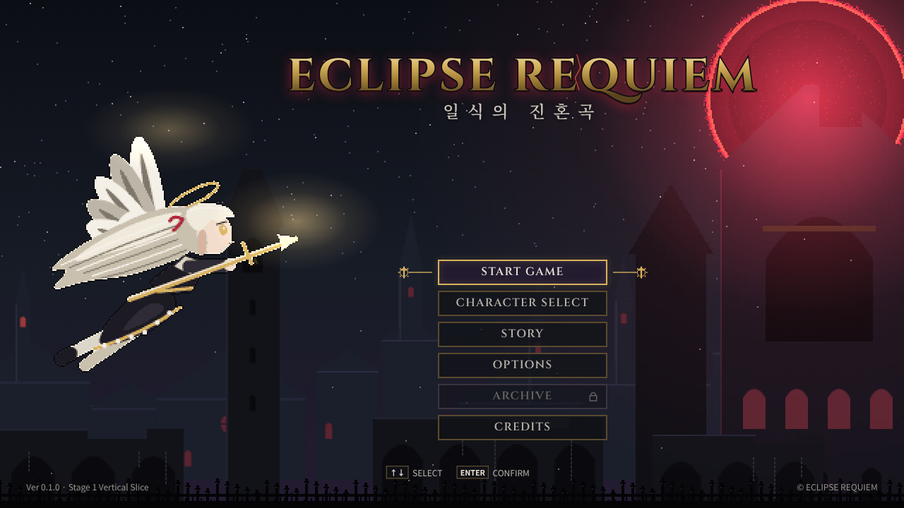 | 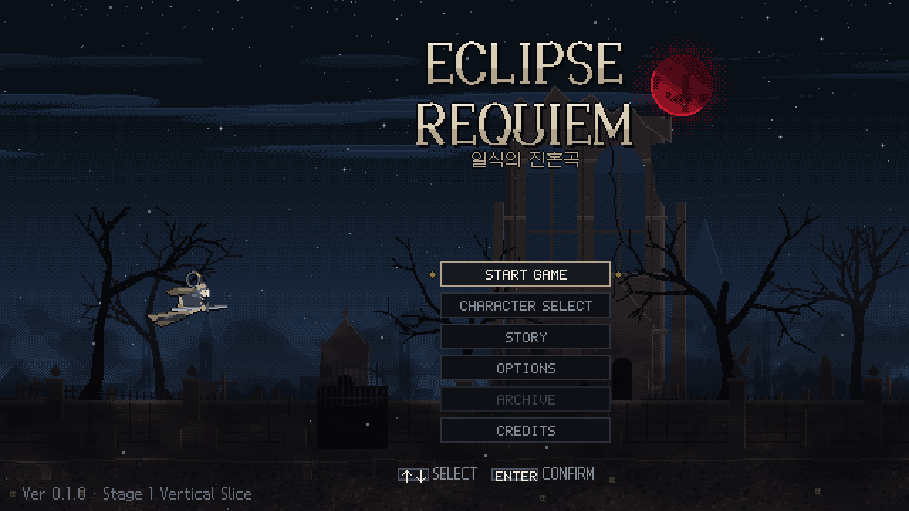 |
| 캐릭터 선택 | 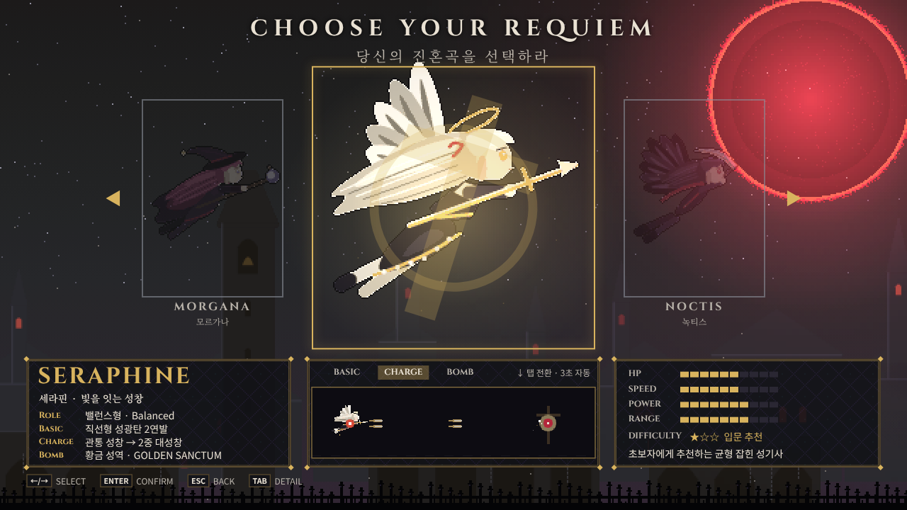 | 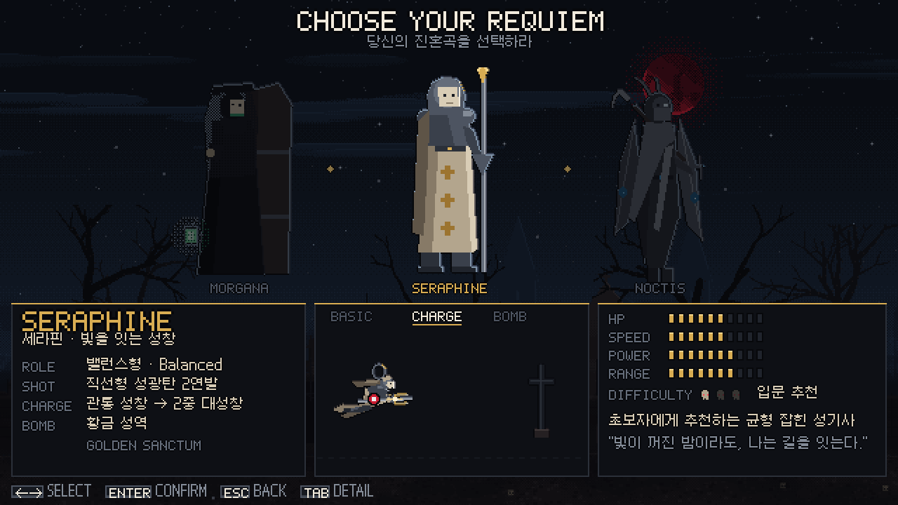 |
| 구간 A | 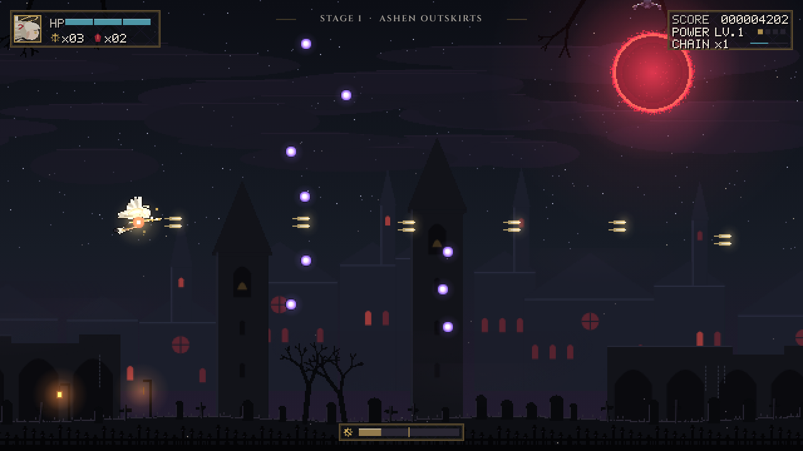 | 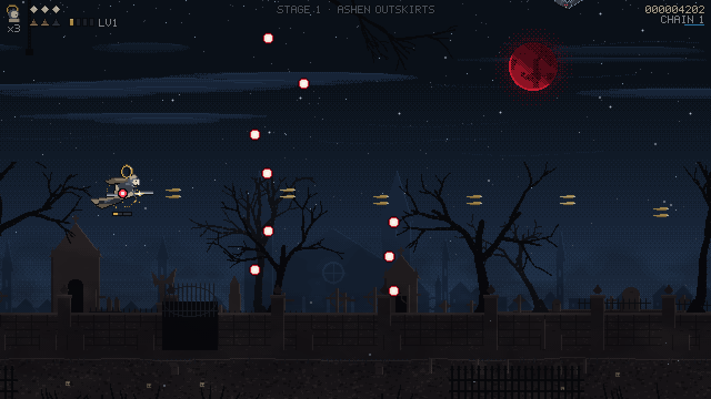 |
| 구간 B | 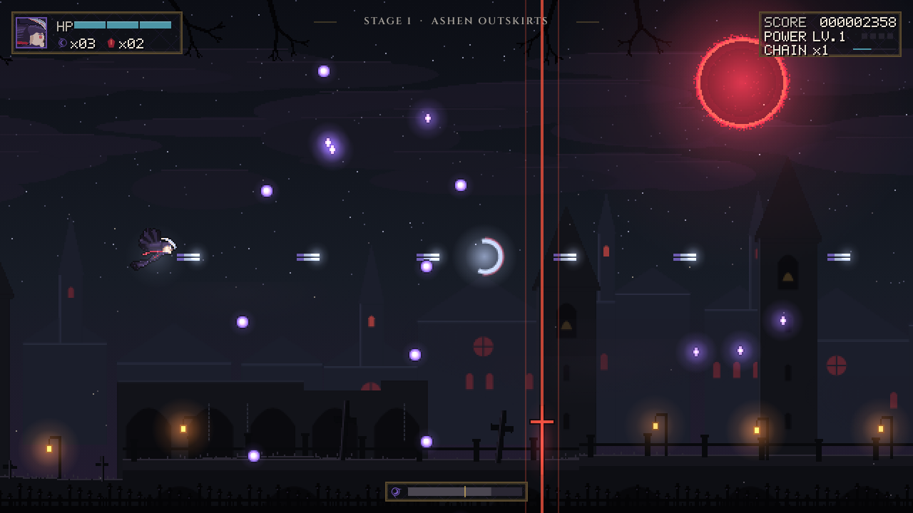 | 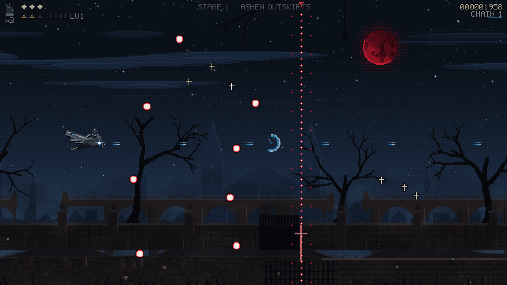 |
| 구간 C 검은 안개 | 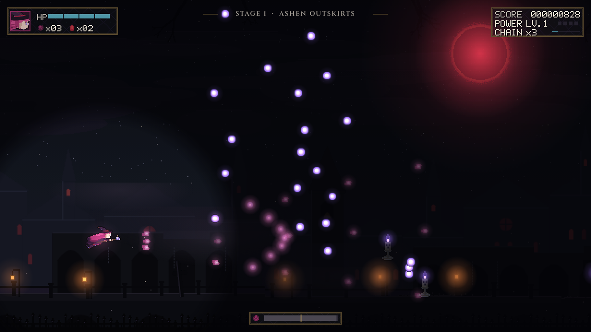 | 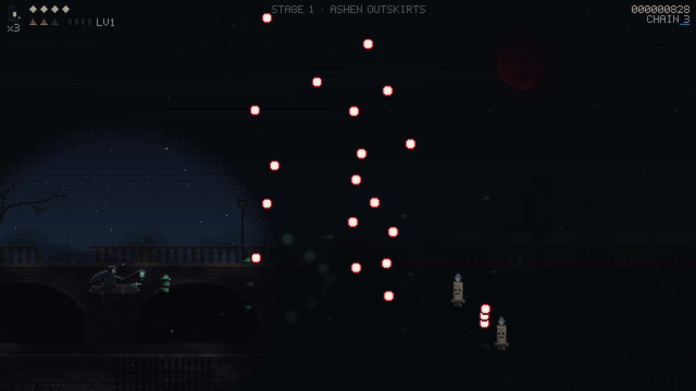 |
| 미니보스 | 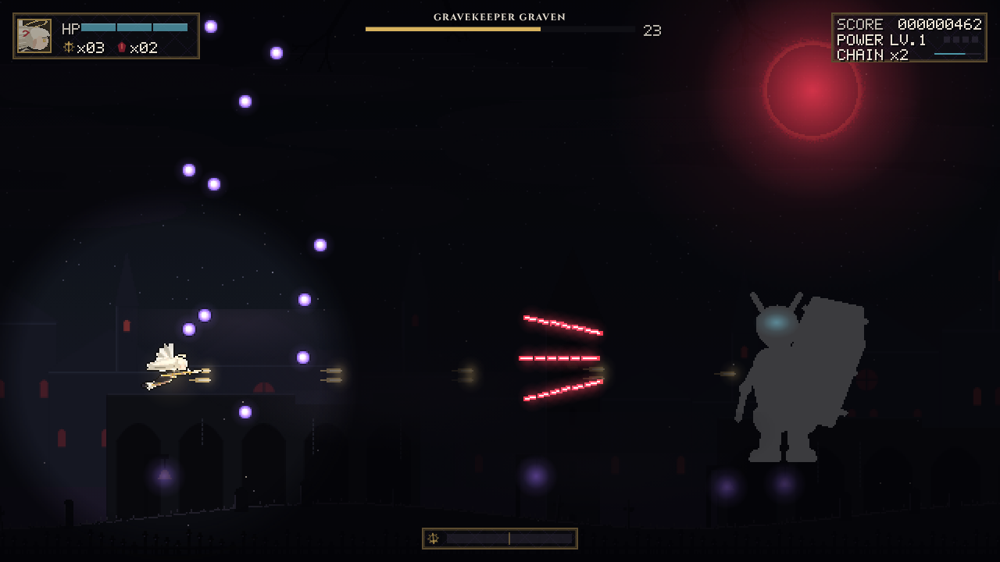 | 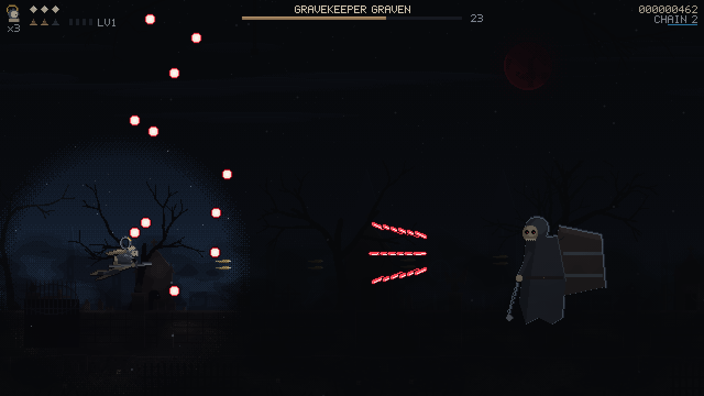 |
| 보스 P1 | 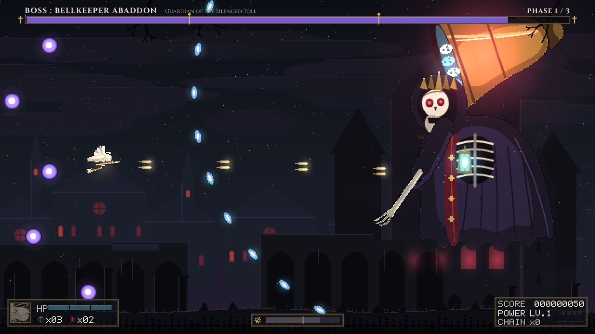 | 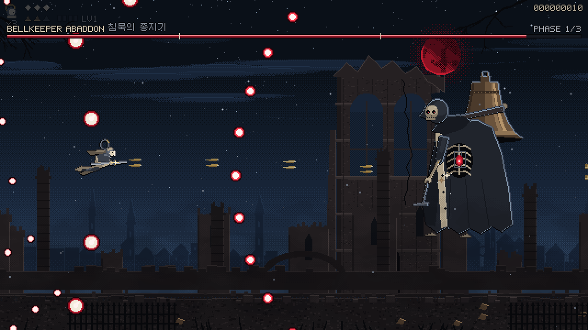 |
| 보스 P3 | 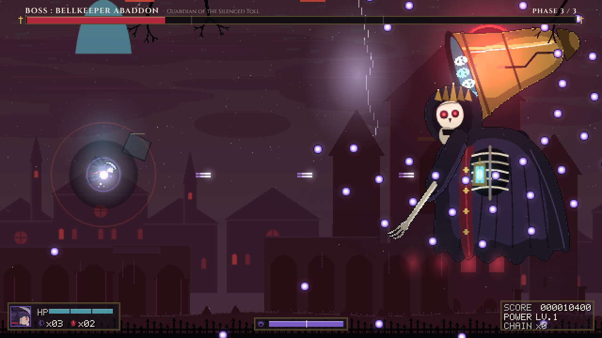 | 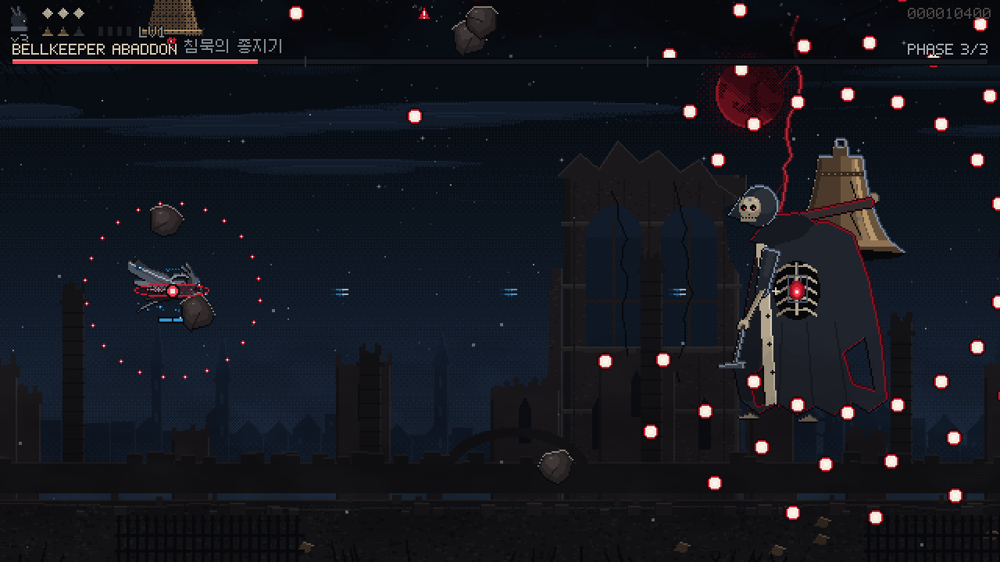 |

## 5. 실행 상태

- `npx tsc --noEmit` 통과, `npm run build` 성공 → `release/eclipse-requiem.html`(단일 파일 1.9 MB, 이미지·폰트 인라인), `release/artifact.html`.
- 릴리스 파일(`file://`)로 캡처·자동 플레이 전부 콘솔 오류 0.

## 6. 기능 테스트 (변경 전후 동일 스크립트)

자동 플레이 봇(`scripts/simulate.mjs`, 60Hz 고정 스텝)으로 이전 커밋(5ebe7ce)과 현재 빌드를 같은 조건에서 비교했다.

| 항목 | 이전 | 이후 | 결과 |
|---|---|---|---|
| 세라핀: 보스 P1/P2 돌파(데미지), 격파 시각 | 224.5 / 249.6 / 270.8 s | 226.0 / 251.3 / 272.5 s | 동일 흐름 |
| 녹티스: P1 시간초과 → P2 → 격파 | 247.3 / 282.6 / 318.0 s | 247.3 / 286.0 / 321.4 s | 동일 흐름 |
| 모르가나: 격파 | 305.5 s | 305.5 s | 동일 |
| 구간 A→B→C→휴지→D, 미니보스 등장·처치 | 정상 | 정상 | 동일 |
| 보스 무피해(idle): 페이즈 시간초과 → 붕괴 → 클리어 | 정상 | 정상 | 동일 |
| 피격 허용(mortal): 잔기 소진 → 게임오버 → 기록 화면 | 정상 | 정상 | 동일 |
| 메뉴 전체(`scripts/screens.mjs`): 인트로→타이틀→프롤로그 스킵→선택→조작법→프리뷰→게임→일시정지·옵션·조작→게임오버→기록 | 정상 | 정상 | 동일 |
| 최대 동시 적탄 | 109 | 110 | — |

검증 중 발견해 고친 문제: 새 보스 그림에 맞춰 줄인 로브 판정원이 코어 앞을 덮어, 코어를 노린 탄이 ×0.2 로 먼저 맞았다(P1 돌파가 24.6초 → 40초 시간초과). 로브 원을 늑골 아래로 옮겨 이전과 같은 진행 시간을 회복했다.

캐릭터 선택·이동·자동 사격·차지·폭탄·적탄·파워업·스테이지 진행·보스 페이즈·게임오버·재시작 로직은 수정하지 않았고(그리기 코드만 교체), 위 테스트로 동작을 확인했다.

## 7. 디자인 바이블 v2 와 달라진 점 (이번 지시서 우선)

- 달: v2의 개기일식(검은 원반+코로나) → 지시서 STEP 6 의 **붉은 월식**.
- HUD: v2의 좌·우 하단 배치 → 지시서 STEP 4 의 **상단 최소 HUD + 상단 3px 보스 바**.
- 보스: v2의 "종 자체가 몸" 안 → 지시서 STEP 7 의 **거대한 종을 짊어진 언데드 사제**(기존 컨셉 유지).

## 8. 미완성 / 남은 작업

1. **실제 아트 미제작**: 모든 그림은 임시 아트다. 특히 초상화(ui/portraits)와 로고가 가장 거칠다. 교체 우선순위와 사양은 `assets/README.md` §5.
2. 일반 적은 대기 + 예고 포즈 2종뿐이고 개별 사망 애니메이션이 없다(공용 폭발 사용).
3. 캐릭터 상하 기울기는 1단계(중간 전환 프레임 없음), 보스 팔은 포즈 교체만 있고 휘두르기 중간 프레임이 없다.
4. 보스 종 안의 유령 얼굴 연출은 빼고 종 입구 발광(`bellglow`)으로 대체했다.
5. 가산 블룸은 제거했다. 빛은 스프라이트의 밝은 색으로만 표현한다. 절제된 블룸이 필요하면 별도 패스로 다시 넣을 수 있다.
6. 옵션·확인 대화상자는 픽셀 텍스트/선으로 바뀌었지만 레이아웃은 기존 그대로다.
7. 오디오, 터치 조작은 이번 범위 밖(변경 없음).
